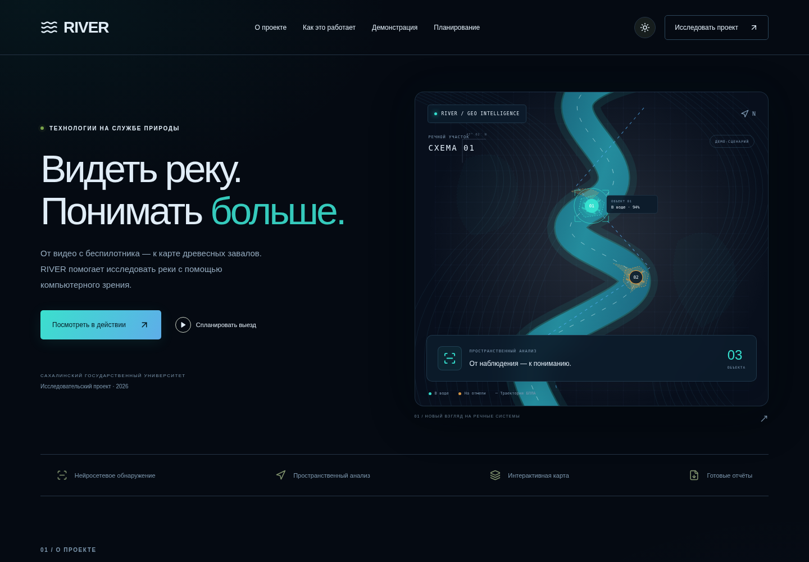
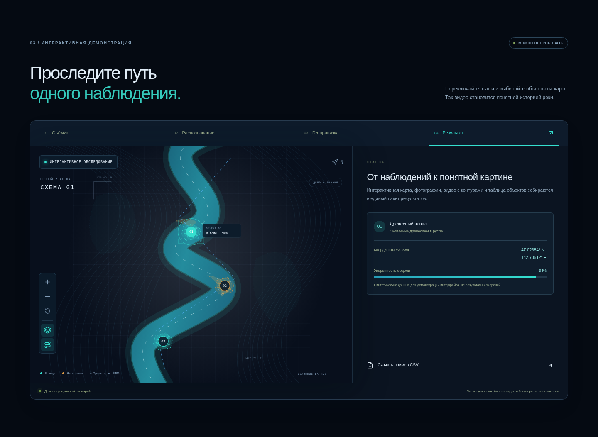
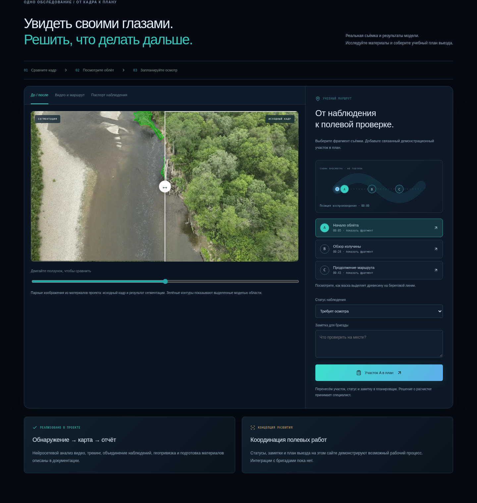

# RIVER — демонстрационный лендинг

Одностраничный сайт исследовательского проекта автоматизированного выявления и пространственного анализа древесных завалов на реках. React 19 + Vite 7. Требуется Node.js >= 20.19 (проверено на 24.22.1) и npm.

## Разработка

```sh
cd /workspace/river_site
npm ci --no-audit --no-fund
npm run dev -- --port 5173
```

## Production-сборка

```sh
npm run build
npm run preview -- --port 4173
```

Содержимое `dist/` можно размещать на статическом хостинге. Серверная часть, ключи API и внешние сервисы не требуются.

## Содержание и ограничения

Основано на предоставленном документе с описанием и фрагментами исходного кода RIVER 1.0.1. Использованы также слайды «Завалы на реках_новое.pptx»: описание данных и этапов работы. Неоднозначные архитектурные утверждения и неподтверждённые оценки точности со слайдов не перенесены. Карта нарисована локально средствами SVG, объекты, координаты и показатели уверенности синтетические. Лендинг не выполняет нейросетевой анализ и не загружает пользовательское видео. Перспективы отмечены как направления развития, а не реализованные функции.

## Проверка

Production-сборка и браузерная проверка Chromium: переходы этапов, выбор объекта, переключение слоя, скачивание CSV, FAQ, мобильное меню и отсутствие горизонтального переполнения при ширине 390 px. Внешних шрифтов и картографических API нет. Тёмная и светлая темы сохраняются в localStorage; при первом посещении учитывается системная тема.

Планировщик — демонстрационная концепция: множественный выбор участков, фильтр по приоритету, дата, бригада, задача, маршрут по течению, локальное сохранение и экспорт JSON. Приоритеты, длины и число завалов условные. Задания не отправляются бригадам; решение о расчистке требует экспертной оценки.

## Видео

Источник: https://github.com/LeraBasargina/AI_Center_site, коммит 3b8ad183d8b63bac9cb33181f0bf67c814d16cde. Файлы media/optimized/segment.mp4 и media/optimized/b-boxes.mp4 перекодированы локально в H.264 1280×720, CRF 26, без аудио, с faststart. Итоговые видео и постер находятся в public/media и входят в production-сборку. Воспроизведение запускает пользователь; автозагрузки полного видео нет (preload=metadata). Оригиналы репозитория не изменены.

## Просмотр без установки и хостинга

`npm run offline` создаёт `RIVER-local.zip`. Распакуйте архив целиком и откройте `RIVER-local/index.html` в обычном браузере. JavaScript и CSS встроены в HTML, видео загружаются из соседней папки `media`. Сервер и интернет не нужны. При запрете localStorage браузером план можно скачать JSON-файлом.

## Обновлённая визуальная концепция

Тёмная тема следует направлению AI_Center_site: глубокий синий фон, бирюзовые и голубые акценты, полупрозрачные панели. Новая схема объединяет топографические линии, градиентную реку, анимацию течения, маршрут и движущийся БПЛА. Бирюзовый и янтарный маркеры различают завалы в воде и на отмели. Выбор доступен мышью и клавиатурой; масштаб, слой объектов и траектория переключаются независимо. Все слои масштабируются в общей системе координат. При prefers-reduced-motion анимации отключены. Схема остаётся условной, не используется для навигации.





## История обследования

В `Mission.jsx` реальные парные изображения `river.jpg` / `seg.jpg` из AI_Center_site используются в сравнении исходного кадра и результата. Доля маски меняется ползунком или перетаскиванием прямо по изображению. Исходные файлы сохранены в public/media как survey-original.jpg и survey-segmentation.jpg.

Контрольные точки 00:05, 00:24 и 00:43 выбирают фрагменты существующего ролика. Позиция просмотра синхронизирована со схемой и списком; переключение модели отображения сохраняет время. Эти точки не объявляются отдельными уникальными завалами. Связь с условными участками A–C учебная: исходной телеметрии и таблицы соответствия объектов кадрам нет. Географическую привязку, реальные расстояния, подъезды и нормативы работ нельзя подтвердить по имеющимся материалам.

Паспорт показывает источник, метод и отсутствие подтверждённой геопривязки. Статус наблюдения и заметка передаются вместе с участком в планировщик, сохраняются в localStorage и входят в экспорт JSON. Выезд остаётся демонстрацией; внешних отправок нет. Блоки «Реализовано» и «Концепция развития» разделяют описанные в документации функции и предлагаемый процесс полевых работ.

Проверено в Chromium: сравнение кадров, переход к фрагменту, сохранение времени при смене отображения, воспроизведение, обновление контрольной точки при перемотке, паспорт, перенос статуса/заметки, восстановление плана, содержимое JSON, темы и отсутствие переполнения на 390/768/1440 px. Автономная сборка проверена на простом статическом сервере без внешних запросов; file:// запрещён политикой облачного браузера.



## Демонстрация и печатный план

Кнопка «Развернуть демонстрацию» открывает рабочее пространство на весь экран вкладки. Escape или «Свернуть демонстрацию» возвращают лендинг; фон недоступен для взаимодействия, фокус удерживается внутри и возвращается после закрытия. Переход «Участок … в план» закрывает развёрнутый режим и прокручивает к планировщику. Browser Fullscreen API не требуется: режим работает и при локальном открытии.

После выбора участков и даты доступна кнопка «Печатный план / PDF». Предпросмотр содержит текущие, в том числе ещё не сохранённые, значения формы: дату, бригаду, задачу, маршрут, участки, статусы и заметки. «Печать / сохранить PDF» открывает системный диалог печати браузера; для PDF выберите соответствующий принтер. Печатные стили скрывают сайт и элементы управления, оставляют белый документ формата A4 независимо от темы. Никаких данных наружу не передаётся.

Проверено: полноэкранный режим, Escape и восстановление фона, переход к плану, содержимое предпросмотра, генерация PDF в Chromium и извлечение его текста, отсутствие элементов лендинга в печати, мобильная ширина 390 px и блокировка печати пустого плана.

## Полевая лаборатория на настоящей съёмке

Блок `FieldLab.jsx` использует фотографии из материалов проекта, без синтетической речной сцены. Посетитель может поставить до шести отметок на исходном изображении, удалить отметку, отменить последнюю, раскрыть сохранённый результат сегментации и начать заново. Управление доступно мышью, касанием и клавиатурой: стрелки перемещают прицел, Enter добавляет отметку. Баллы и показатели точности не рассчитываются: эталонной экспертной разметки нет. Модель в браузере не запускается.

Для объяснения объединения наблюдений извлечены реальные кадры river-segmentation.mp4 на 00:20, 00:22 и 00:24 без изменения изображений. Древесное скопление у правого берега визуально прослежено между кадрами. Три шага показывают наблюдения, подсветку ориентира и одну учебную карточку T-01. T-01 не является подтверждённым идентификатором ByteTrack; журнал треков не предоставлен. Каждый кадр можно открыть крупно, диалог закрывается кнопкой или Escape.

Проверено в Chromium: отметки мышью и клавиатурой, удаление, отмена, ограничение количества, раскрытие/сброс, шаги объединения, открытие кадров, Escape, темы и отсутствие горизонтального переполнения на 390/768/1440 px. Существующий сценарий сравнения, видео и переноса заметок в план также проверен.

## Структура и повторяемые проверки

- `src/main.jsx` — страница и навигация.
- `src/RiverScene.jsx`, `FieldLab.jsx`, `Mission.jsx` — речная сцена, фотолаборатория и обследование.
- `src/Planner.jsx`, `PrintPlan.jsx` — план и печатный документ.
- `src/lib/plan-storage.js` — проверка сохранённых данных и общие варианты полей.
- `src/style.css` — базовые стили; `src/styles/` — речная сцена, обследование, презентация/печать и фотолаборатория в порядке каскада.
- `tests/` — тесты восстановления плана и браузерная регрессия.

`npm test` проверяет четыре группы сценариев сохранения, типов данных и календарных дат. Для браузерной регрессии запустите `npm run dev -- --port 5173`, затем в другом терминале `npm run test:browser`. Требуется Chromium: используется установленный `/usr/bin/chromium`, либо браузер Playwright (`npx playwright install chromium`), либо путь из `CHROMIUM_PATH`. Адрес сервера можно задать через `BASE_URL`.

При проверке исправлены аварийное восстановление повреждённых данных localStorage, перенос заметок между разными участками и некорректное значение сохранённой темы. Заметки каждого участка теперь независимы. Формирование ZIP включает только файлы актуальной сборки, без устаревших медиа. Неиспользуемый ProjectVideo.jsx удалён.

Полные ручные браузерные сценарии проверены в Chromium: карта/слои, фото/отметки, видео/перемотка, план/экспорт/сохранение, полноэкранный режим, печать/PDF. Это не подтверждает работу во всех версиях Safari/Firefox. Картографические и производственные сценарии остаются демонстрационными; закрытые данные для этой проверки не требовались.

## Выбор изображения в фотолаборатории

Добавлены три вида одной подтверждённой пары: общий план и увеличенные вдвое верхний/нижний фрагменты береговой линии. Интерфейс явно обозначает их как фрагменты одного снимка, а не новые места съёмки. Исходное изображение и результат модели получают строго одинаковое масштабирование и центр преобразования. Отметки, прицел и раскрытие результата независимы для каждого вида и сохраняются при переключении до перезагрузки. Сброс затрагивает только выбранный вид. Для новых независимых фотозаданий нужны дополнительные чистые снимки и соответствующие им результаты сегментации; удаление нарисованных масок из видеокадров не использовалось.

Проверены независимость состояний, возврат к отметкам, совпадение преобразований оригинала и маски, обе темы и ширины 320/390/768/1440 px.

## Актуальная фотолаборатория: только видео

По уточнению пользователя в блоке поиска теперь ровно три задания из синхронных роликов b-boxes.mp4 и segment.mp4 на 00:12, 00:36 и 00:52. Кадры вырезаны из одинаковых областей обоих видео. В выбранных областях b-box нет видимых рамок, текстовых подписей и заголовков; в segment есть сохранённые маски. Это не восстановленные исходники: разметка не стиралась и изображение не генерировалось. Обрезки визуально проверены. Источники, коммит и точные координаты crop записаны в public/media/spotter/provenance.json.

Предыдущие фотофрагменты и три загруженных DJI JPG не подключены к этому заданию. Пользовательские исходные файлы сохранены в репозитории. Отметки и открытие масок независимы для каждого из трёх заданий, сброс затрагивает только выбранный кадр. Проверены все пары, совпадение размеров оригинала/результата, отсутствие запросов к DJI-фотографиям из интерфейса и адаптивность 320–1440 px.
